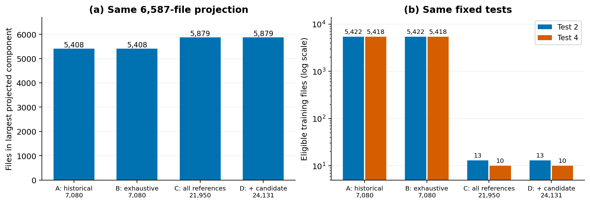
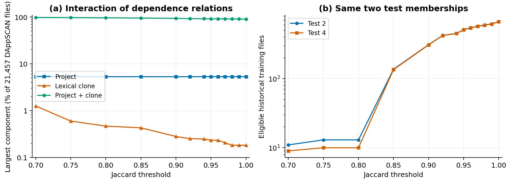
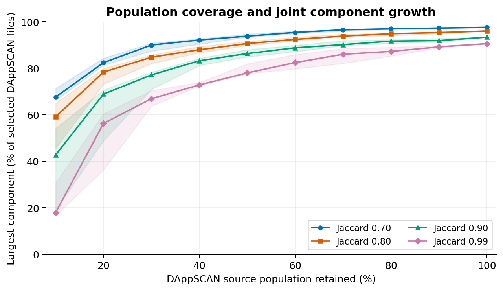
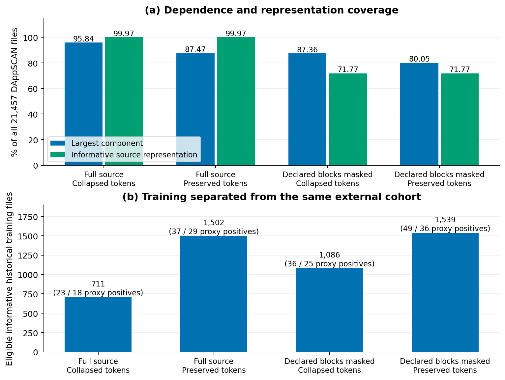
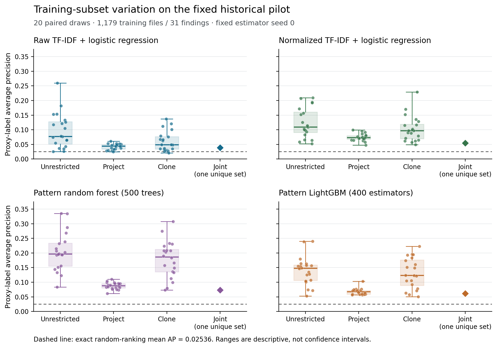
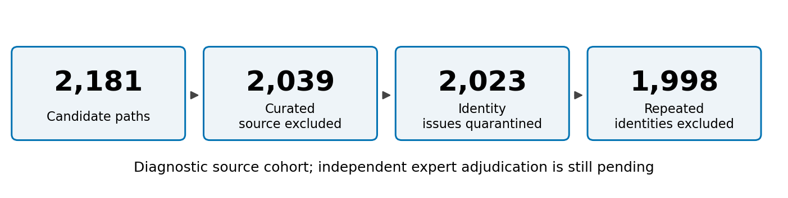

# Population Coverage and Dependency-Aware Evaluation of Smart Contract Vulnerability Detectors

Oleksandr Kuznetsov¹˒²

¹ Department of Theoretical and Applied Sciences, eCampus University, Italy.

² Department of Intelligent Software Systems and Technologies, School of Computer Science and Artificial Intelligence, V.N. Karazin Kharkiv National University, Ukraine.

ORCID: [0000-0003-2331-6326](https://orcid.org/0000-0003-2331-6326)

## Abstract

Evaluating vulnerability detectors on related smart contracts requires decisions about both the grouping relation and the source population on which it is constructed. Files omitted from a benchmark can connect its training and test groups. We investigate this problem through population ablation, representation sensitivity and a fixed-test development experiment. Keeping evaluation files unchanged, expanding dependency construction to uncapped reference sources reduces the eligible training sets of two previously feasible tests from more than 5,400 files to 13 and 10. Among 21,457 audit-derived Solidity files, project membership and normalized lexical similarity jointly connect 95.95% at Jaccard 0.8, although neither relation alone creates a dominant component. Project membership combined with exact normalized-stream equality still connects 90.05%, compared with 16.82% for raw-byte equality. Preserving identifiers and masking library/interface declarations reduces the 0.8 component to 80.05%. Thus concentration depends on both population coverage and representation; it does not establish semantic identity or universal split impossibility. Twenty paired training draws show substantial conditional score variation; raw-token logistic-regression AP under unrestricted training ranges from 0.0256 to 0.2600 on the same historical test. A separate external-source audit identifies overlap and annotation-mapping constraints without scoring that cohort. Evaluation reports should document dependency construction before subset selection, distinguish graph-retained from usable training support, and separate conditional proxy-label scores from independently verified vulnerability detection.

**Keywords:** smart contracts; vulnerability detection; evaluation methodology; code clones; dataset provenance; source coverage

## 1. Introduction

A detector evaluated on a held-out source file may still have access to closely related training code. The relationship can be direct, as when two files are duplicates, or indirect, as when one file belongs to the same project as a clone of another file. Consequently, splitting by project and splitting by clones address different relations. Taking their union is conservative, but it can also make many apparently separate observations part of one connected component.

There is a further choice that is easy to overlook: which files participate in dependency construction. A study may cap the number of files from large projects to control computation or class imbalance, construct groups on that reduced population, and then evaluate models. Files omitted from the benchmark can nevertheless connect groups that remain in it. Adding these files need not change a single training example, test example or label to change which train/test combinations satisfy the stated separation rule. This paper investigates that distinction between the evaluation population and the population used to establish dependencies.

The question matters for smart-contract security because reuse is common and evaluation resources have different annotation origins. A manually annotated example, an injected defect and a finding extracted from an audit report support different interpretations. A source file with no recorded audit finding is not necessarily safe. Published detector scores can therefore mix dependence between files, selection of particular projects, model variability and uncertainty in the target labels. An evaluation should identify which of these quantities it actually measures.

Our starting point is a previously reported historical DAppSCAN experiment described in Chapter 13 of *Custom AI Solutions for Blockchain Systems: Detection and Prevention of Anomalies* [1]. Its capped population and large joint component are prior evidence, not new findings of this article. We retain that population as a fixed projection and extend the analysis to uncapped sources, exhaustive lexical screening, alternative representations and repeated training draws. We also examine whether a recently released annotated corpus can serve as an external evaluation population.

The study addresses four research questions:

- **RQ1:** How does the source population used to construct dependencies affect the component structure and admissible training sets of a fixed evaluation population?
- **RQ2:** Which dependence assumptions and source constructs account for large components, and how stable are the findings across thresholds and lexical representations?
- **RQ3:** On a fixed historical development test, how much score variation is attributable to training-subset selection and to estimator randomness, separately?
- **RQ4:** Which source, dependency and annotation conditions are satisfied by a proposed external cohort, and which remain unverified?

The contributions are a controlled analysis of population-dependent training eligibility; an examination of project–clone interactions through threshold, representation and connectivity diagnostics; a conditional analysis of model-score variability on one unchanged test; and a reproducible source and overlap audit for a proposed external cohort. These contributions concern evaluation, not a new detector. The graph analyses explain the consequences of explicit dependency assumptions, while the model experiment measures stability conditional on historical data. Neither is presented as independently confirmed performance on new deployment families.

## 2. Related work

Leakage and duplication are established evaluation problems. Kaufman et al. [2] relate leakage to legitimate prediction information and the modeling objective, while Kapoor and Narayanan [3] examine its consequences for scientific ML practice. DéjàVu maps duplication in source repositories [4], and Allamanis [5] studies the effect of duplicated code on model evaluation. Our question is narrower than whether duplication matters: how does the population used to construct transitive dependence change eligibility among the same benchmark files?

Vulnerability-detection research provides further reasons to separate benchmark scores from security capability. Chakraborty et al. [6] examine dataset artifacts, class distributions and realistic evaluation. Croft et al. [7] study annotation and duplication problems in vulnerability datasets. PrimeVul combines improved labeling, deduplication and chronological evaluation [8]. Risse and Böhme [9] use transformations and vulnerable/patched pairs to expose limitations that conventional evaluation misses. Risse, Liu and Böhme [10] examine missing context and spurious correlations in function-level benchmarks. These findings motivate our bounded interpretation of file-level proxy-label AP; our graph study does not replace semantic or patch-discrimination tests.

For Solidity, Kondo et al. [11] analyze clone prevalence, clone clusters and OpenZeppelin reuse. Their work establishes that cloning and libraries are relevant; a large component alone is therefore insufficient novelty. SmartBugs supports reproducible tool execution [12], alongside an earlier empirical comparison of analyzers [13]. SolidiFI evaluates tools using injected bugs [14], whereas DAppSCAN derives weaknesses from project audit reports [15]. These annotation regimes must remain distinguishable in a combined study.

Recent evaluations also challenge simple transfers between benchmarks. Salzano et al. [16] release line-level annotations and compare multiple tools. Khalid et al. [17] compare static and LLM-based tools on SmartBugs and an audit-derived FORGE subset. We do not claim that external validation, deduplication or fixed tests are new ideas. The distinct empirical question here is the effect of graph construction outside a fixed evaluation subset, together with the feasibility consequences of combining project relations and code reuse. The controlled population ablation is central to that claim. We make no exhaustive priority claim for this targeted comparison with prior work.

## 3. Study design

### 3.1 Source populations and labels

The study fixes repository revisions rather than treating corpus names as immutable datasets. Table 1 distinguishes the source inventory used in this study from counts reported for other releases of the associated papers.

**Table 1. Source populations and their role.**

| Source | Files at the studied revision | Annotation origin | Role |
| --- | ---: | --- | --- |
| DAppSCAN | 21,457 | Published audit findings | Main graph population; historical subset for model diagnostics |
| SmartBugs-curated | 143 | Curated vulnerable examples and annotated locations | Reference source and historical graph context |
| SolidiFI-benchmark | 350 | Defect injection into 50 base contracts across seven folders | Reference source and historical graph context |
| Salzano replication corpus | 2,181 paths | Source-reported manual line annotations | Candidate external cohort; no model scoring |

The first three sources total 21,950 paths; including the external candidate gives 24,131. Their pins are respectively `66a56619c44770e05c2db600fa6468115ff0dcd5`, `230e649123477eff332742a59a1c7cc6dc286cab`, `4b0573e1b3f7031396de6f48f7f3e7380222ad3a` and `da079440bf2cf4fd803c864ef29aeea8a3da50c3`.

The historical population contains 6,587 DAppSCAN files and all 493 reference files, totaling 7,080. The adapter retains every DAppSCAN file linked to a source-annotation record, including records for weaknesses outside the selected classes. This gives 948 metadata-linked files. It then retains at most 20 other files per project directory. Project directories and source paths are sorted; a single Python `random.Random(0)` generator shuffles each directory's unannotated list before truncation. The result adds 5,639 files without annotation records. The cap was a computational choice intended to prevent large repositories from dominating; it is label-informed and is not a probability sample of the full corpus. The uncapped inventory contains the same 948 metadata-linked files and 20,509 others, across 608 observed project-directory groups.

The primary classes are reentrancy and unchecked calls. DAppSCAN SWC-107 and SWC-104 map to these classes. The historical and full populations each contain 114 and 74 corresponding positive files. A zero means no corresponding published finding in the adapter, including files that have other findings. It does not mean expert-confirmed absence. Model results against these targets are called **proxy-label performance**. Source-reported negative annotations, unresolved records and confirmed negative judgments are not merged into this status.

### 3.2 Dependencies, projection and training eligibility

Let \(U\) be the population on which dependencies are constructed, and let \(G_U=(U,E_U)\) be an undirected graph defined by a fixed representation and relation. For project relations, each DAppSCAN directory is a group, each SolidiFI base-contract index links its injected variants, and each SmartBugs file is its own group. Candidate files with equal lowercase source identifiers are linked separately when the external population is present. Raw-byte equality and lexical similarity provide additional relations. Their connected components are dependency proxies, not verified real-world families.

For an evaluation population \(S\subseteq U\), write \(\Pi_U|_S\) for the partition obtained by intersecting every connected component of \(G_U\) with \(S\) and discarding empty intersections. This is a **projection of a connected partition**. It differs from taking the induced graph \(G_U[S]\) and computing components afterward: an otherwise omitted file in \(U\setminus S\) can lie on a path between two members of \(S\).

For a fixed test \(T\subset S\), the admissible joint-disjoint training pool is

\[
A_U(S,T)=\{x\in S\setminus T: C_U(x)\cap T=\varnothing\},
\]

where \(C_U(x)\) is the component containing \(x\). Exact test objects are always excluded. Project-only and clone-only pools apply the corresponding relation rather than their union.

An elementary graph fact explains the direction of the population effect. If \(S\subseteq U\subseteq V\) and the pairwise relation is unchanged, then \(\Pi_U|_S\) refines \(\Pi_V|_S\), and \(A_V(S,T)\subseteq A_U(S,T)\). Every path available in \(U\) remains available in \(V\); adding vertices and edges can join existing components but cannot separate them. This observation is not a new theorem. Its empirical consequences depend on the source population and relation. It also does not imply that the giant-component *fraction* must increase when the denominator changes from one sampled population to another.

We report component counts, largest-component size and the concentration summary

\[
D_2(S;U)=\frac{|S|^2}{\sum_j |C_j(U)\cap S|^2}.
\]

This inverse-Simpson quantity describes the balance of component sizes. It is not an estimate of the number of statistically independent observations and is not used to determine confidence intervals or power.

### 3.3 Lexical relations and population ablation

The historical graph used normalized token five-grams, MinHash LSH candidates and CRC32-shingle Jaccard verification at 0.8. New audits use exhaustive sparse set intersections with 128-bit BLAKE2b shingle digests. With shingle sets \(Q(a),Q(b)\), lexical Jaccard is

\[
J(a,b)=\frac{|Q(a)\cap Q(b)|}{|Q(a)\cup Q(b)|}.
\]

The exhaustive claim concerns this representation and digest scheme, not semantic equivalence. Exact raw-source hashes are checked separately. An additional control compares project closure with raw-byte equality, exact ordered normalized-stream equality, and normalized-stream equality restricted to nonempty streams. This separates approximate similarity from information lost during normalization. Project and identity groups are conceptual equivalence relations; their storage as compact star links does not alter the partition. When constructing a subpopulation, these links are regenerated rather than filtered through a possibly omitted star center.

The A–D ablation at threshold 0.8 separates four graphs: A, the saved historical graph; B, exhaustive construction on the same 7,080 files; C, exhaustive construction on all 21,950 reference files; and D, construction after adding the 2,181 candidate paths. Every comparison projects onto the same historical DAppSCAN files and tests. Thus A–B examines the changed discovery procedure, B–C examines uncapped reference coverage, and C–D examines the additional candidate sources.

For sensitivity analysis, we evaluate project-only, clone-only and joint relations at 13 thresholds: 0.70, 0.75, 0.80, 0.85, 0.90, 0.92, 0.94, 0.95, 0.96, 0.97, 0.98, 0.99 and 1.00. Five deterministic path-hash rankings give nested 10%–90% DAppSCAN prefixes; the full population is the common 100% endpoint. The other 493 reference files remain present. These source selections use no labels. The historical cap is shown separately because it follows a different selection rule.

To examine connectivity mechanisms, we contract declared projects into vertices and collapse cross-project lexical links into simple edges. Equal-byte groups connect every represented project pair, rather than choosing an arbitrary star center. We compute articulation vertices and bridges on this graph, weighting vertices by their DAppSCAN file counts. A removal statistic counts files separated from the largest remaining piece after excluding the removed project's own files. This measures structural fragility; it is not a recommendation to delete projects to obtain a preferred split.

### 3.4 Representation sensitivity

The legacy normalizer removes comments using regular expressions, then collapses most identifiers and numeric literals while retaining selected Solidity keywords, types and API names. A string-aware scanner changes comment recognition while leaving the other token rules unchanged. This isolates one implementation issue from the broader effect of identifier normalization.

A further two-by-two sensitivity design compares full source with source whose balanced top-level `library` and `interface` declarations are masked, and collapsed identifiers/numbers with preserved identifiers/numbers. The scanner is lexical structure extraction, not a compiler AST. Declared contracts, including abstract contracts, remain; source outside the masked blocks is retained. Masking does not remove inherited library implementations, copied library code inside contracts, or all third-party origins. The graph retains nodes and explicit identity/project relations even when a lexical representation becomes uninformative. A structural scan failure suppresses lexical representation in the masked variants, without a partial-mask fallback; the full-file variants retain the corrected source tokens.

Besides Jaccard, this analysis uses \(|Q(a)\cap Q(b)|/\min(|Q(a)|,|Q(b)|)\), the maximum of the two directional containment fractions. The resulting value is symmetric: it tests whether most of the smaller representation is contained in the larger one. It should not be described as a directed dependency proof. Both similarities are assessed at 0.70, 0.80, 0.90, 0.95 and 0.99. Extraction failures and missing lexical information are recorded explicitly. All four variants suppress lexical relations between empty representations, while retaining their graph nodes. The preceding threshold experiment preserves the inherited empty-shingle policy; its results are therefore reported separately from this controlled factorial comparison.

Because concatenating residual source can create five-grams across a removed declaration, a separately frozen post-hoc control forms shingles within each retained source segment. It preserves the masking decisions, token conventions, graph population and explicit relations; only boundary-spanning shingles are suppressed.

### 3.5 Fixed-test model variability

The model study predicts reentrancy proxy labels on the original 1,082-file development test, selected by a label-blind hash ranking of 20% of the largest historical component. It contains 21 positives and belongs to one historical joint component. Unchecked-call findings enter the separate feasibility analyses, not this model experiment. No candidate external file is scored. The four training regimes exclude exact test objects only, all represented projects, all represented clone components, or the full transitive project–clone components.

Every training draw contains 1,179 files and 31 proxy positives. Within each label value, the same deterministic path rank pairs the draw across regimes, and the minimum available class count determines the matched sample size. Twenty draw indices vary this ranking. The joint pool itself contains exactly 1,179 files, so its twenty draws have identical membership. The main panel fixes the estimator seed at zero; a separate panel varies tree-model seeds 0–19 on this one joint pool. This distinguishes variation from selecting training files from variation inside the estimator. Identical configurations and ordered memberships reuse a fitted model with explicit provenance.

**Table 2. Model configurations; no hyperparameter search.**

| Method or stage | Configuration |
| --- | --- |
| Raw-token LR | Historical tokenizer with comments removed and identifiers/numbers preserved; TF-IDF and logistic regression below |
| Normalized-token LR | Same historical tokenizer with identifier/number collapsing; TF-IDF and logistic regression below |
| TF-IDF, both LR methods | Token pattern `\S+`; 1–3-grams; minimum document frequency 2; at most 50,000 features; sublinear term frequency; no lowercasing |
| Scaling and LR | Training-fitted `StandardScaler(with_mean=False)`; `lbfgs`; C=1; balanced class weights; tolerance 0.0001; maximum 3,000 iterations |
| Pattern random forest | 43 source-pattern features; 500 trees; balanced-subsample weights; minimum leaf size 1; four worker threads |
| Pattern LightGBM | Same 43 features; 400 estimators; learning rate 0.05; 31 leaves; row fraction 0.8 every iteration; column fraction 0.8; balanced weights; four worker threads |
| Estimator randomness | Main panel seed 0; separate fixed-joint-pool tree panel seeds 0–19 |

The pattern vector includes 38 counts of calls, checks, authorization, arithmetic, state and control-flow constructs, normalized per 100 nonempty source lines; a call-before-write heuristic; a parsed compiler-version value and pre-0.8 indicator; and log-transformed line and function counts. These are lexical heuristics, not formal vulnerability predicates. Vectorizers and scalers are fitted on training data only. The model feature code remains historical, including its legacy comment removal, so a graph-normalization sensitivity does not silently change the model experiment.

We report sklearn average precision, not trapezoidal precision–recall area, and review yield at 54, 108 and 216 files, corresponding to floor budgets of 5%, 10% and 20%. Boundary score ties use the expected positive count under uniform tie ordering and the attainable range. Failures retain missing scores and explicit status. Draw summaries and paired differences are descriptive conditional distributions, not intervals for unseen projects.

For a uniformly random distinct ranking of \(N>1\) files containing \(1\le K\le N\) positives, the exact finite-sample expectation is

\[
\mathbb E[\mathrm{AP}]=\frac{H_N}{N}+\frac{(K-1)(N-H_N)}{N(N-1)},
\qquad H_N=\sum_{r=1}^{N}\frac1r.
\]

To see this, expand AP as \(K^{-1}\sum_r I_r(\sum_{j\le r}I_j)/r\), using \(\mathbb E I_r=K/N\) and \(\mathbb E I_rI_j=K(K-1)/(N(N-1))\) for distinct positions. For the fixed test, the expectation is 0.025363, whereas prevalence is 0.019409. Exhaustive small-case checks and a 10,000-permutation reference verify the calculation. The random-ranking reference is not an inferential permutation test: file-label exchangeability and independent-family replication have not been established.

### 3.6 External-cohort audit

We reconcile candidate records by source and identifier, check annotated locations against the saved source, and retain conflicting or unresolved cases. The diagnostic cohort excludes prior SmartBugs-curated exposure, then source-reconciliation disputes and repeated identities. These rules change the target population and are reported explicitly. We screen both direct lexical overlap and full transitive reachability before constructing training exclusions. The proposed response is to preserve test coverage where possible and restrict related training sources, rather than remove inconvenient external cases based on scores.

Human confirmation is a separate task. A prepared review form is not evidence that an annotation is correct. This study reports source consistency and recorded dependency, while a probability-based, independently assessed annotation review and external model evaluation remain prospective.

### 3.7 AI assistance and computational verification

OpenAI ChatGPT/Codex in Work Mode, using the GPT-6 model family and accessed on 25–26 October 2026, assisted with code development, analysis orchestration, literature retrieval and reference checking, manuscript drafting, and visualization code. The exact model build was not recorded. Reported empirical values were obtained by executing versioned scripts against the pinned source inventories and saved configurations, rather than inferred from language-model responses. Source hashes, executable snapshots, configurations and calculation outputs provide the computational record.

Figures were rendered programmatically with Matplotlib from the reported data; an image-generation model was not used. Separately implemented component reconstruction, literal-shingle checks and source-hash checks provide additional software verification. The term independent verification refers to these computational checks, including separately implemented checks prepared with AI assistance. It does not denote review by independent human experts, semantic adjudication of vulnerability labels, or an independently sampled external performance evaluation.

## 4. Results

### 4.1 RQ1: Source coverage changes eligibility on fixed files

The historical DAppSCAN projection has 227 joint components at threshold 0.8, with 5,408 of 6,587 files in the largest component. This 82.10% result was already part of the book baseline. Table 3 reports the new controlled ablation on that same projection.

**Table 3. Population ablation at Jaccard 0.8.**

| Graph | Construction population | Components among the same 6,587 files | Largest projected component | Eligible training for test 2 / test 4 |
| --- | ---: | ---: | ---: | ---: |
| A: saved historical | 7,080 | 227 | 5,408 | 5,422 / 5,418 |
| B: exhaustive historical | 7,080 | 227 | 5,408 | 5,422 / 5,418 |
| C: uncapped references | 21,950 | 198 | 5,879 | 13 / 10 |
| D: references plus candidate | 24,131 | 197 | 5,879 | 13 / 10 |

A and B have identical projected partitions. Thus exhaustive discovery on the original population does not explain the observed change. C enlarges the projected largest component to 89.25% and reproduces the training collapse before the candidate external files are added. D merges another projected component without further changing the two eligible training counts. Both comment-removal implementations give the same result at 0.8. Within this construction and these fixed tests, uncapped reference coverage is sufficient to explain the loss of training support.

The two tests each contain 1,062 files outside the historical giant component, or 16.12% of historical DAppSCAN. They were identified from 95 deterministic proposals using proxy-positive counts and component-dispersion screens after the initial pilot. Under the historical graph they pass those screens, but under the expanded graph their training pools contain respectively zero/one and one/zero reentrancy/unchecked positives. The tests share 961 files and are not independent replications.

Across all 95 proposals, neither normalizer nor address policy yields a passing design at thresholds 0.7, 0.8 or 0.9: zero of 1,140 design–graph combinations satisfies all original screens. The criteria required at least 500 matched training files, 20 training positives and 20 test positives per class, plus component-dispersion conditions. These are operational criteria rather than a power calculation. The failure concerns those proposals under that relation; it is not a proof that every group-disjoint evaluation is impossible.

*Figure 1. The source population used for graph construction changes connectivity among the same original files. A–B holds population fixed, B–C adds uncapped reference sources, and C–D adds candidate sources. Training counts concern the two fixed 1,062-file test sets, not the original 1,082-file model diagnostic.*

### 4.2 RQ2: Large components arise from combining relations

On the complete 21,457-file DAppSCAN inventory, the largest project-only component has 1,132 files (5.28%), and the largest clone-only component at 0.8 has 100 files (0.47%). Their union connects 20,588 files (95.95%). This is an interaction between project membership and code reuse across projects, rather than one enormous lexical clone family.

The distinction persists at more restrictive thresholds. At 1.0, lexical edges require identical normalized shingle sets, but the largest joint component still contains 19,321 files (90.05%); the largest clone-only component contains 39 (0.18%). The joint concentration summary rises from 1.086 at 0.8 to 1.233 at 1.0. These values describe dominance by a large component, not approximately one independent observation in a statistical model. Equality of lossy shingle sets also remains different from equality of source bytes or behavior.

Exact-identity controls sharpen this distinction. Project membership combined only with raw-byte equality yields a largest component of 3,608 files (16.82%). Replacing byte equality with exact ordered normalized-stream equality produces 19,321 (90.05%); excluding empty streams from that equality gives 19,298 (89.94%). Approximate near-match edges are therefore unnecessary for a dominant component under this normalization. Conversely, these results do not establish dominance under raw-source identity. The six empty normalized sources account for 23 attached full-corpus files, rather than the overall concentration.

*Figure 2. (a) Largest-component shares across lexical thresholds on all 21,457 DAppSCAN files, with project-only and clone-only relations shown separately from their union on a logarithmic axis. (b) Eligible historical training for the two fixed 1,062-file tests. The full-population 95.95% and historical-projection 89.25% values have different denominators.*

Nested source coverage shows that the historical cap is not the only way to expose this behavior. At 0.8, the median largest-component fraction across five label-blind 10% prefixes is 59.11%, with a range of 45.59%–64.85%. At 50% coverage the median is 90.57%, and at 90% it is 95.27%. The complete-population value is 95.95%. The five rankings measure sensitivity to these source selections, not uncertainty over independent corpora. No critical threshold or formal percolation transition is inferred.

*Figure 3. Nested path-hash selections vary the share of DAppSCAN source files present during dependency construction. Other reference sources remain fixed. Lines show the median and shading the minimum–maximum across five specified rankings, not confidence intervals. The historical label-informed cap is a separate comparator.*

The contracted full-reference graph at 0.8 has 801 vertices and 6,848 simple cross-project links. Its 26 weighted articulation projects and 55 bridges do not identify a single project whose removal dismantles the dominant component. After excluding the removed project's own files, at most 82 DAppSCAN files separate from the largest remaining piece following one project removal. The result suggests distributed connectivity under the relation. It does not establish that each connecting file is a security-relevant dependency or a recognized library.

The highest-impact project bridge is supported by Tenderize's `Faucet.sol` and Livepeer's `LivepeerTokenFaucet.sol` at Jaccard 0.804878; neither witness declares a library or interface. A second bridge joins PieDAO's `IAToken.sol` and Fei's `IFeiRewardsDistributor.sol` at 0.809524; both declare interfaces, and the smaller side contains 36 files. These deliberately selected witnesses illustrate heterogeneous connectors. They do not estimate the prevalence of semantic libraries or prove that an individual witness file is indispensable.

Increasing the threshold restores some training support for the two fixed tests, but does not by itself validate a new experiment. At 0.95 the retained training counts are 513/510; at 1.0 they are 671/669. At the latter threshold the reentrancy/unchecked positive counts are only 11/9 and 12/8. These results explain why numerical train-size feasibility and adequate class support must be reported separately.

The factorial analysis confirms that the representation materially changes both concentration and training support (Table 4). To compare all variants on the same empty-input policy, the six empty sources have no lexical edges. This changes the full-source normalized baseline from 20,588 to 20,565 files in the dominant component. In the external diagnostic comparison it changes graph-retained historical DAppSCAN training from 691 to 712 files, of which 711 have informative representations. This small but explicit policy change must not be attributed to identifier preservation or masking.

**Table 4. Representation sensitivity at Jaccard 0.8.** All variants retain 24,131 graph nodes and the same 1,998 candidate test files. The largest component is projected onto all 21,457 DAppSCAN files. Training columns concern the historical 6,587-file DAppSCAN population after excluding components touching that fixed candidate test; positive counts are among informative retained files.

| Source representation | Identifiers and numbers | Largest DAppSCAN component | Graph-retained training | Informative retained training | Retained proxy positives, reentrancy / unchecked |
| --- | --- | ---: | ---: | ---: | ---: |
| Full file | Collapsed | 20,565 (95.84%) | 712 | 711 | 23 / 18 |
| Full file | Preserved | 18,769 (87.47%) | 1,504 | 1,502 | 37 / 29 |
| Library/interface declarations masked | Collapsed | 18,745 (87.36%) | 1,520 | 1,086 | 36 / 25 |
| Library/interface declarations masked | Preserved | 17,177 (80.05%) | 2,150 | 1,539 | 49 / 36 |

Preserving identifiers/numbers and masking declarations each reduces concentration, but their combination still leaves four-fifths of DAppSCAN connected. Masking also makes 6,061 of all 24,131 source representations uninformative, including three candidate test files. One source fails structural scanning and therefore has no masked representation; this is not a compiler-validity judgment. Thus increased graph-retained training is not equivalent to increased usable lexical training. These counts concern lexical availability, not detector accuracy or annotation validity.

Containment produces larger components than Jaccard under every variant at 0.8: 21,454, 20,824, 21,430 and 19,336 DAppSCAN files, respectively in Table 4 order. Its ability to connect a small representation to a much larger file therefore does not resolve concentration here. It changes which reuse patterns count as dependencies and can make transitive exclusion more restrictive.

*Figure 4. Factorial lexical sensitivity at Jaccard 0.8. (a) Component concentration and informative coverage use all 21,457 DAppSCAN files as denominator. (b) Informative historical training after separation from the same 1,998 candidate files; parentheses give reentrancy/unchecked proxy positives. Masking concatenates residual tokens; the separate segmented control checks boundary-spanning shingles. Three candidate files become uninformative after masking. No external model performance is measured.*

The segmented-mask control leaves the Jaccard 0.8 largest-component and candidate-separated training counts in both masked rows unchanged, although some memberships change. With containment, informative training changes from 22 to 41 files for collapsed tokens and from 739 to 740 for preserved tokens. Thus the main Jaccard summaries are not explained by newly boundary-spanning shingles, but the control does not establish partition invariance or validate masking as semantic library removal.

### 4.3 RQ3: Conditional score variation on the historical test

All evaluations returned scores for every test file, with no failed fit or convergence warning. The four raw-LR draw-zero score vectors reproduce the original pilot exactly. Table 5 summarizes the completed 20-draw experiment. Each unrestricted, project-disjoint and clone-disjoint cell has 20 distinct training memberships. Each joint cell has one membership and one fitted model, reused across draw indices; its zero selection variation is a design consequence.

**Table 5. Conditional proxy-label AP across 20 paired training draws.** Cells give mean [minimum, maximum], with estimator seed fixed at zero. The joint column is one fixed score. These ranges describe training selection on the same 1,082-file historical test, not uncertainty over new projects.

| Method | Unrestricted | Project-disjoint | Clone-disjoint | Joint-disjoint |
| --- | ---: | ---: | ---: | ---: |
| Raw-token LR | 0.0965 [0.0256, 0.2600] | 0.0420 [0.0243, 0.0608] | 0.0603 [0.0204, 0.1371] | 0.0385 |
| Normalized-token LR | 0.1229 [0.0524, 0.2092] | 0.0740 [0.0478, 0.0993] | 0.1032 [0.0487, 0.2293] | 0.0546 |
| Pattern random forest | 0.2041 [0.0833, 0.3348] | 0.0876 [0.0611, 0.1099] | 0.1787 [0.0731, 0.3077] | 0.0730 |
| Pattern LightGBM | 0.1399 [0.0526, 0.2400] | 0.0680 [0.0567, 0.1029] | 0.1305 [0.0502, 0.2226] | 0.0616 |

Training selection can reverse the ordering seen in the initial draw. Raw-LR project-disjoint AP was initially below joint-disjoint AP, but its mean paired difference is +0.003573; it is positive in 12 of 20 draws. The descriptive 2.5% and 97.5% quantiles are −0.012647 and +0.018556. Raw clone-disjoint training likewise exceeds joint training in 12 draws. Unrestricted means exceed joint scores for all four methods, yet the raw-LR unrestricted range spans 0.025599–0.259966. These results establish conditional sensitivity to training composition, not a causal estimate of leakage or evidence that every observed difference is random noise. All six paired regime contrasts are retained in the accompanying tables.

*Figure 5. Twenty paired training draws per method and regime on the unchanged historical test. Dots show draw outcomes; boxes show medians and interquartile ranges; whiskers show observed extrema. Joint training uses one complete pool, displayed as a diamond. The dashed line is exact expected AP under a uniform strict random ranking, not prevalence or an inferential threshold. No interval represents uncertainty over unseen families.*

Estimator randomness contributes a different source of variation. Across 20 seeds on the same joint pool, random-forest AP has mean 0.079056, SD 0.003595 and range 0.073009–0.087179. LightGBM has mean 0.073541, SD 0.018984 and range 0.053175–0.113831. These distributions must not be combined with the training-draw distributions as independent test repetitions.

Review budgets provide a complementary interpretation. At 54 reviews, the fixed joint raw LR, normalized LR, random forest and LightGBM recover respectively 3, 3, 5 and 3 of the 21 recorded findings; at 216 reviews they recover 6, 9, 14 and 13. AP ordering need not hold at every budget: raw project-disjoint training has higher mean AP than joint training but retrieves only 2.65 findings on average at 54 reviews, compared with the joint model's 3. These remain proxy-label yields on a reused test, not externally validated detection rates.

### 4.4 RQ4: External eligibility requires more than a new repository

The candidate has 2,182 compact-manifest rows, 2,180 source/identifier keys and 2,181 saved source paths. Seventeen paths require reconciliation: fourteen annotated locations exceed saved source length, two repeated keys have differing annotations, and one path lacks a manifest row. An apparent identifier transcription mismatch remains quarantined. A location mismatch is evidence of inconsistent source mapping, not proof that a vulnerability finding is false.

Against all reference sources, 142 candidate paths match raw bytes, 148 match normalized streams, and 208 have a direct lexical relation at Jaccard 0.8. All exact-byte overlaps belong to the previously used curated source. The diagnostic selection leaves 2,039 files after curated-source exclusion, 2,023 after unresolved-source quarantine and 1,998 after repeated-identity quarantine. These remaining files contain 46 reentrancy and 200 unchecked source-reported positives.

*Figure 6. Source-based selection of the diagnostic external cohort. The 1,998 retained files are a provisional population, not an independently verified test. Source exclusions and training restrictions are different decisions. Of 17 originally problematic paths, one is removed by the earlier curated-source exclusion.*

Direct screening is insufficient for transitive separation. Among the 1,998 retained files, 65 have a direct 0.8 lexical relation to reference data, whereas 186 in 11 proxy components are connected transitively. Retaining the entire diagnostic test and excluding connected historical training components leaves 691 DAppSCAN files, with 23 reentrancy and 18 unchecked proxy positives. Another 350 SolidiFI and 134 SmartBugs files remain, but their different annotation origins cannot be used to conceal the loss of DAppSCAN support in a pooled positive count. DAppSCAN retention changes from 418 at threshold 0.7 to 1,085 at 0.9.

The string-aware scanner changes 92 of 24,131 normalized streams without a scan failure. Fourteen lexical edges disappear at 0.7, none at 0.8 or 0.9, and no training-retention decision changes at those thresholds. Adding 80 equal-address links also changes no partition. These are useful robustness checks for this dataset, rather than evidence that representation choices or deployment provenance are generally unimportant.

No independent human vulnerability assessments or external model scores have been completed. The audit establishes reproducible source and dependency conditions, while annotation correctness, deployment-family identity and external performance remain separate empirical questions.

## 5. Discussion and implications

The population ablation shows why selecting a benchmark and then computing dependency groups can answer a different question from computing dependencies first and then selecting benchmark files. The omitted sources do not need to be training examples to matter. They can provide paths connecting retained observations. A paper that reports only its final split membership omits part of the evidence needed to understand its separation claim.

The mechanism analysis also shows why project-only and clone-only reports are insufficient substitutes for their union. A project may contain several reusable components, each linking it to a different project. A chain of such overlaps can join projects without requiring all files to resemble each other. Conversely, the existence of a path does not prove that two distant files convey the same vulnerability information. The scientific issue is choosing and defending a relation appropriate to the intended generalization target, not maximizing or minimizing the component count.

For benchmark curators, the results motivate retaining source-population manifests even when computation uses a smaller labeled subset. Releases should state the annotation unit, label origin, source revision and missing-label meaning. They should also distinguish dependency evidence from identity evidence: lexical equality is useful for overlap screening but should not silently resolve a disputed source identifier.

For detector authors, a split description should specify the graph population, edge definition, transitive rule and actual retained training support. When two protocols are compared, a common test and matched training counts make the comparison easier to interpret. They do not control every composition difference. Repeated training draws and separate estimator seeds describe that conditional variation, while new-project claims require independently informative test populations.

For practitioners selecting security tools, benchmark AP should be read together with workload, coverage and annotation provenance. A source-proxy zero does not justify calling a warning a false positive. Failed analyses should not receive safe scores. Reporting how many files are successfully analyzed and how many known findings are recovered within a review budget is more informative than a ranking metric alone, although it still depends on the benchmark's target labels.

Together, these distinctions support transparent evaluation without prescribing a universally correct grouping rule. Stricter exclusion can change the prediction task as well as reduce overlap.

## 6. Threats to validity

**Dependency construct.** Directory projects, lexical overlap and identifier equality are proxies. Identifier/number collapsing can join semantically different code; strict equality can miss meaningful adaptations. Full closure is conservative and can exaggerate dependence relevant to a particular detector. Alternative thresholds, masking and containment examine this sensitivity but do not identify a uniquely correct relation. Structural masking is not compiler-level contract/function extraction, and project articulation is not evidence of library authorship.

**Labels and task.** DAppSCAN's absence of a published finding is a proxy zero. Source annotation records may be incomplete or inconsistent. The external source audit does not replace independent adjudication, and file-level classification lacks some deployment and calling context. No error rate for underlying vulnerability truth is estimated. Different annotation regimes remain separate in interpretation.

**Statistical interpretation.** The model test is historically inspected and contains one observed joint component. Training-draw quantiles characterize the specified resampling procedure, not uncertainty over new projects. Paired draws share files and are not independent test replications. The random-ranking reference does not provide an exchangeability-based p-value. The 95 design proposals and their count screens are a bounded, post-pilot feasibility analysis rather than an exhaustive search or power calculation.

**External validity.** The pinned sources cover particular Solidity versions, audits and collection procedures. The source coverage curves condition on one corpus and five chosen rankings. Their component fractions are not estimates for all deployed smart contracts. Equal-looking addresses lack confirmed network and deployment identity. The candidate cohort remains provisional, and no external accuracy claim is made.

**Implementation and reproducibility.** Exhaustive intersections eliminate LSH candidate omission for the chosen digest representation, but not representation error. Independent component reconstruction, source-hash checks and small-case tests reduce implementation risk. Model features intentionally retain historical behavior, while graph sensitivities use separately identified representations. Complete executable snapshots and the record of earlier recovery and reruns are included with the artifact.

## 7. Conclusion

Dependency-aware evaluation depends on the population used to establish connectivity, not only on the final train/test files. Expanding source coverage reduces two fixed tests' eligible training pools to 13 and 10 files under the stated relation. Project closure amplifies normalized lexical links, but raw-byte equality produces substantially less concentration. Representation choices therefore require explicit justification. Separately, repeated training draws change proxy-label scores and can reverse an initial regime ordering. These findings support reporting population projection, usable class-specific training support and conditional score variation together. The external-source audit prepares a further evaluation; it does not supply independently verified labels or external performance.

## Data and code availability

The study code, configurations, source hashes, aggregate results and derived predictions are maintained in the [article branch of blockchain-detector-eval](https://github.com/KuznetsovKarazin/blockchain-detector-eval/tree/paper/security-evaluation). Compressed membership and edge outputs are currently absent from this public checkpoint; recovery hashes and verification reports are included, and a complete public deposit remains pending. An article-specific archival identifier has not been minted. The forthcoming book [1] supplies the historical baseline; the article adds the population, mechanism, sensitivity and eligibility analyses described here. Third-party source code and copied annotation keys are excluded from the article artifact; corpus-wide redistribution rights remain unresolved.

Six original compressed lexical-edge archives from the representation analyses could not be recovered. Separately identified replacements were recomputed from fixed source snapshots and pinned inputs. For these analyses, all 120 reported component partitions and 20 saved tabular outputs were reproduced, and the six membership archives matched their original hashes. The recomputed edge archives do not match the original byte hashes; agreement of partitions and tables does not establish identity of the complete original edge lists. The artifact preserves this distinction and documents the additional software checks in its recovery record.

## Declaration of generative AI and AI-assisted technologies in the manuscript preparation process

OpenAI ChatGPT/Codex in Work Mode (GPT-6 family; accessed 25–26 October 2026) assisted with literature retrieval and reference checks, manuscript organization and drafting, and preparation of analysis and visualization code. Research-related use and computational checks are described in Section 3.7. The exact model build was not recorded. The author retains responsibility for the scientific interpretation and final content; the tools are not authors.

## References

[1] Kuznetsov, Oleksandr (forthcoming). *Custom AI Solutions for Blockchain Systems: Detection and Prevention of Anomalies*. CRC Press / Taylor & Francis. Chapter 13 supplies the historical baseline disclosed in this study.

[2] Shachar Kaufman; Saharon Rosset; Claudia Perlich; Ori Stitelman (2012). Leakage in data mining: Formulation, detection, and avoidance. *ACM Transactions on Knowledge Discovery from Data*. [10.1145/2382577.2382579](https://doi.org/10.1145/2382577.2382579).

[3] Sayash Kapoor; Arvind Narayanan (2023). Leakage and the reproducibility crisis in machine-learning-based science. *Patterns*. [10.1016/j.patter.2023.100804](https://doi.org/10.1016/j.patter.2023.100804).

[4] Cristina V. Lopes; Petr Maj; Pedro Martins; Vaibhav Saini; Di Yang; Jakub Zitny; Hitesh Sajnani; Jan Vitek (2017). DéjàVu: A Map of Code Duplicates on GitHub. *Proceedings of the ACM on Programming Languages*. [10.1145/3133908](https://doi.org/10.1145/3133908).

[5] Miltiadis Allamanis (2019). The Adverse Effects of Code Duplication in Machine Learning Models of Code. *Proceedings of the 2019 ACM SIGPLAN International Symposium on New Ideas, New Paradigms, and Reflections on Programming and Software (Onward!)*. [10.1145/3359591.3359735](https://doi.org/10.1145/3359591.3359735).

[6] Saikat Chakraborty; Rahul Krishna; Yangruibo Ding; Baishakhi Ray (2022). Deep Learning Based Vulnerability Detection: Are We There Yet? *IEEE Transactions on Software Engineering*. [10.1109/TSE.2021.3087402](https://doi.org/10.1109/TSE.2021.3087402).

[7] Roland Croft; M. Ali Babar; Mehdi Kholoosi (2023). Data Quality for Software Vulnerability Datasets. *2023 IEEE/ACM 45th International Conference on Software Engineering (ICSE)*. [10.1109/ICSE48619.2023.00022](https://doi.org/10.1109/ICSE48619.2023.00022).

[8] Yangruibo Ding; Yanjun Fu; Omniyyah Ibrahim; Chawin Sitawarin; Xinyun Chen; Basel Alomair; David Wagner; Baishakhi Ray; Yizheng Chen (2025). Vulnerability Detection with Code Language Models: How Far Are We? *2025 IEEE/ACM 47th International Conference on Software Engineering (ICSE)*. [10.1109/ICSE55347.2025.00038](https://doi.org/10.1109/ICSE55347.2025.00038).

[9] Niklas Risse; Marcel Böhme (2024). Uncovering the Limits of Machine Learning for Automatic Vulnerability Detection. *33rd USENIX Security Symposium (USENIX Security 24)*. [Official proceedings](https://www.usenix.org/conference/usenixsecurity24/presentation/risse).

[10] Niklas Risse; Jing Liu; Marcel Böhme (2025). Top Score on the Wrong Exam: On Benchmarking in Machine Learning for Vulnerability Detection. *Proceedings of the ACM on Software Engineering*. [10.1145/3728887](https://doi.org/10.1145/3728887).

[11] Masanari Kondo; Gustavo A. Oliva; Zhen Ming (Jack) Jiang; Ahmed E. Hassan; Osamu Mizuno (2020). Code cloning in smart contracts: a case study on verified contracts from the Ethereum blockchain platform. *Empirical Software Engineering*. [10.1007/s10664-020-09852-5](https://doi.org/10.1007/s10664-020-09852-5).

[12] João F. Ferreira; Pedro Cruz; Thomas Durieux; Rui Abreu (2020). SmartBugs: A Framework to Analyze Solidity Smart Contracts. *Proceedings of the 35th IEEE/ACM International Conference on Automated Software Engineering (ASE)*. [10.1145/3324884.3415298](https://doi.org/10.1145/3324884.3415298).

[13] Thomas Durieux; João F. Ferreira; Rui Abreu; Pedro Cruz (2020). Empirical Review of Automated Analysis Tools on 47,587 Ethereum Smart Contracts. *Proceedings of the 42nd International Conference on Software Engineering (ICSE)*. [10.1145/3377811.3380364](https://doi.org/10.1145/3377811.3380364).

[14] Asem Ghaleb; Karthik Pattabiraman (2020). How Effective Are Smart Contract Analysis Tools? Evaluating Smart Contract Static Analysis Tools Using Bug Injection. *Proceedings of the 29th ACM SIGSOFT International Symposium on Software Testing and Analysis (ISSTA)*. [10.1145/3395363.3397385](https://doi.org/10.1145/3395363.3397385).

[15] Zibin Zheng; Jianzhong Su; Jiachi Chen; David Lo; Zhijie Zhong; Mingxi Ye (2024). DAppSCAN: Building Large-Scale Datasets for Smart Contract Weaknesses in DApp Projects. *IEEE Transactions on Software Engineering*. [10.1109/TSE.2024.3383422](https://doi.org/10.1109/TSE.2024.3383422).

[16] Francesco Salzano; Cosmo Kevin Antenucci; Simone Scalabrino; Giovanni Rosa; Rocco Oliveto; Remo Pareschi (2026). An empirical analysis of vulnerability detection tools for solidity smart contracts. *Empirical Software Engineering*. [10.1007/s10664-026-10867-7](https://doi.org/10.1007/s10664-026-10867-7).

[17] Shawal Khalid; Joaquin Tuckett; Chris Brown (2026). Do Smart Contract Auditing Results Transfer Across Datasets? A Two-Benchmark Empirical Study of Static and LLM-Based Security Tools. *20th International Symposium on Empirical Software Engineering and Measurement (ESEM 2026)*. [10.4230/LIPIcs.ESEM.2026.45](https://doi.org/10.4230/LIPIcs.ESEM.2026.45).
