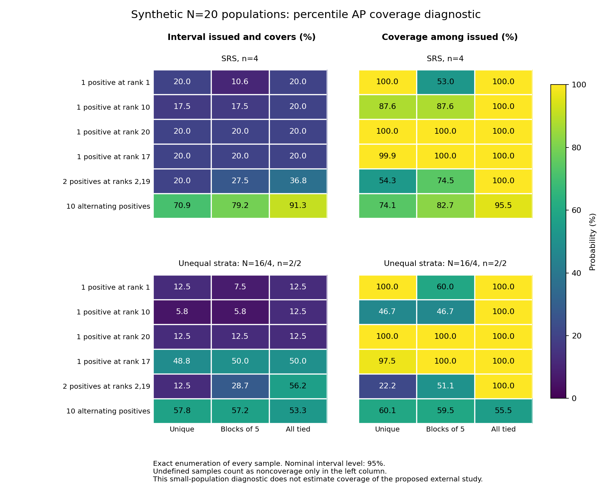

# Rare-positive AP intervals: exact finite-population diagnostic

The nominal 95% percentile AP procedure **does not attain 95% conditional coverage in several prespecified small synthetic populations**. Correct finite-population bootstrap weights and valid replicates do not provide a general coverage guarantee for the nonlinear AP statistic. This is a concrete counterexample study, not an estimate of coverage for the planned 1,998-file/180-case external evaluation.

## Design and verification

All 59 scenarios, 795,934 sample states, the source snapshots and three Monte Carlo seeds were frozen before computation in `run_20261026_v1/design_before_results.json` (SHA256 `7ba5af80247414d1769bcdfb3e0323ed475332a3322464f0a4ec2f5058fedc35`). The main factorial used N=20; SRS n=4, unequal N=16/4 strata with n=2/2, and census; unique scores, ties in blocks of five, and all-tied scores; six fixed positive patterns. Extra guards covered no positives and N=50 with one positive. All outcomes, identifiers and scores are fictional. No actual project labels, predictions or judgments were used.

Every possible sample was enumerated. Grouping identical weighted-AP configurations reduced computation to606 configurations without approximating their sampling probabilities. The complete finite bootstrap support was enumerated with exact integer probability masses. Its discrete percentile endpoints were compared with unchanged v1 weight generation using2,000 replicates and each of three fixed seeds. All reported coverage and mean-width results were identical across these four endpoint calculations in this grid; this is not a promise that three seeds suffice elsewhere.

The run completed in60.9 seconds. Ten complete production-wrapper checks agreed with support lookup. A separate verifier independently re-enumerated all795,934 sampling states, checked4,495 weighted AP values by a scalar formula, enumerated10,347 ordered bootstrap sequences, and recomputed236 summary rows. All665 checkpoint-file hashes passed. A resume on a separate complete copy preserved675 numerical/source files; only that copy's run-metadata timestamps changed. The original run and v1 implementation remain unchanged.

## Main results

The table deliberately separates three probabilities. “Issued and covering” counts undefined/unissued intervals as failures to deliver a covering interval. “Coverage when issued” conditions on receiving an interval. The former is not silently substituted for the latter, and undefined AP is never set to zero.

The v1 API separately retains the safe range[0,1] when the population is assumed to contain a positive. That logical range is not a percentile interval and is not counted as an issued bootstrap interval here; the diagnostic does not remove or invalidate it.

| Synthetic population and design | True AP | Interval issued | Issued and covering | Coverage when issued | Mean width when issued |
| --- | ---: | ---: | ---: | ---: | ---: |
| N20, SRS4, one positive in top tied block of5 | 0.200000 | 20.00% | 10.61% | 53.04% | 0.483751 |
| N20, unequal strata, one positive at rank10, unique scores | 0.100000 | 12.50% | 5.83% | 46.67% | 0.769440 |
| N20, unequal strata, positives at ranks2 and19, unique scores | 0.302632 | 56.25% | 12.50% | 22.22% | 0.216290 |
| N50, SRS4, one positive at rank25, unique scores | 0.040000 | 8.00% | 7.00% | 87.52% | 0.808188 |
| N20, SRS4, ten alternating positives, all scores tied | 0.500000 | 95.67% | 91.33% | 95.47% | 0.699525 |

Across all39 positive-population noncensus cases, coverage conditional on issuance ranged from22.22% to100%;16 cases were below95%. These are properties of the specified finite grid, not estimates of failure prevalence across arbitrary datasets. Issuance ranged from8.00% to96.11%. All18 positive-population census controls returned exact point intervals with100% coverage. Both no-positive-population guards correctly returned undefined AP, with coverage left undefined.

There were **no invalid bootstrap replicates in positive-containing samples**. Nonetheless, the first example issued zero-width intervals in46.96% of its positive-containing samples, and those intervals missed the truth. In the unequal-strata two-positive example,67.41% of issued intervals had zero width. Invalid-replicate checks therefore cannot serve as a calibration test. The full table includes invalid fractions over all samples separately from the positive-sample fractions; no-positive samples have undefined AP and all their requested replicates are flagged invalid.

## An independently countable counterexample

There is one positive in the highest score-tie group of five among20 units. The true AP is1/5. An SRS of four includes the positive with probability4/20. Conditional on including it, there are `C(19,3)=969` equally probable choices of the other three units. In `C(15,3)=455` choices, none of the four other highest-tie units is sampled.

In those455 samples the positive is alone at the highest observed score. Every rescaled-bootstrap weight remains positive, so every replicate has AP=1 and the percentile interval is[1,1], missing the true0.2. The implemented procedure covers the truth in the remaining514 samples: conditional coverage is exactly514/969=53.0444%, and the probability of issuing a covering interval is514/4845=10.6089%. This counting argument is independent of the enumeration code and shows why adding bootstrap draws does not repair this example.



## Consequences for the prospective protocol

The v1 implementation can remain a reproducible **diagnostic** for its declared weighted plug-in estimator. Its percentile output should not be promoted to validated primary 95% uncertainty merely because weight-variance identities, numerical tests, or invalid-replicate guards pass. Before prospective use as inferential evidence, the protocol needs an explicit uncertainty-method decision justified for its target estimand and design. A separate sensitivity analysis or a method with justified bounds may be warranted; no replacement method was tuned in this study.

A point estimate, an interval's nominal level, its actual finite-population coverage and the chance of obtaining any interval are distinct. Reporting must retain these distinctions and the possibility of unknown outcomes. This study does not establish performance on unseen projects, account for reviewer mistakes, or estimate model-training variability. Its small N/n and artificial rankings do not quantify the actual external design's coverage, and no universal minimum-positive or sample-size threshold follows from it.

The external scoring gate was not changed. No human reviews or external model results were created. Statistical formula provenance remains documented in the unchanged `performance_v1/REFERENCES.json`; the present findings follow from the synthetic definitions and exact enumeration, not an asserted AP coverage theorem.

## Artifacts

- `DESIGN.md` and `run_20261026_v1/design_before_results.json`: prospective scenario and endpoint definitions.
- `run_20261026_v1/summary.csv`: all236 scenario/method summaries, including widths, undefined frequencies, biases and RMSEs.
- `run_20261026_v1/scenarios/` and `configurations/`: full grouped exact sample distributions and production-evaluated bootstrap supports.
- `INDEPENDENT_VERIFICATION.json`, `verify_validation.py`, and `RESUME_VERIFICATION.json`: independent arithmetic, exact counting and resumability checks.
- `coverage_diagnostic.svg` / `.png`, `plot_validation.py`, and `figure_provenance.json`: the complete36-case main noncensus factorial, without selection by coverage.

For a fresh reproduction, use a new output directory:

```bash
python papers/security_evaluation/revision1/external_protocol/performance_validation_v1/run_validation.py prepare --out NEW_DIRECTORY
python papers/security_evaluation/revision1/external_protocol/performance_validation_v1/run_validation.py run --out NEW_DIRECTORY
```

The frozen runner may resume a matching existing run; source/configuration hashes are checked before execution. Existing audit receipts are not overwritten.
